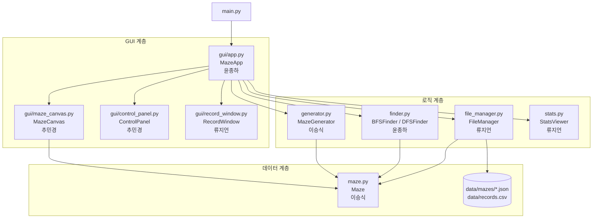
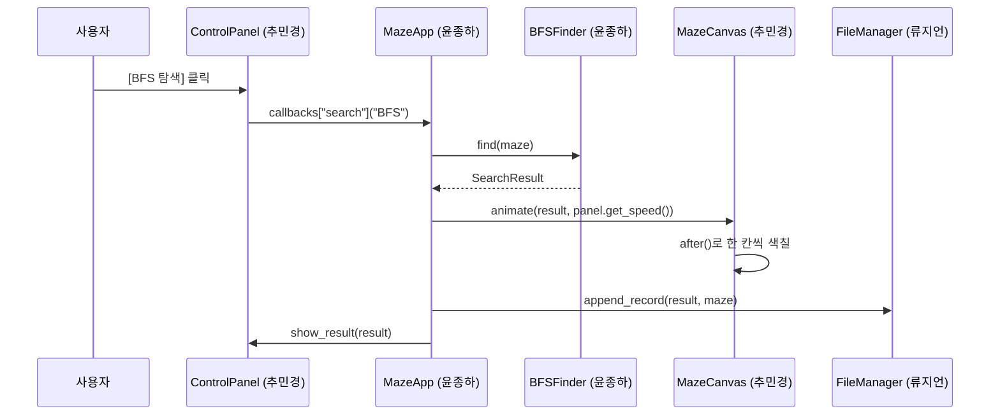

# 경로 탐색 알고리즘 학습 시각화 프로그램

> 2026-2 프로그래밍 II 팀프로젝트 | 4TEAM
> 미로를 생성하고, BFS(너비 우선 탐색)와 DFS(깊이 우선 탐색)가 길을 찾는 과정을 한 칸씩 보여주는 학습용 프로그램

이 문서는 팀원들이 **각자 맡은 파일을 따로 개발하고, 나중에 문제없이 합칠 수 있도록** 정리한 작업 안내서입니다.
작업을 시작하기 전에 1장부터 4장까지는 꼭 읽어 주세요.

---

## 목차

1. [처음 한 번만 하는 준비](#1-처음-한-번만-하는-준비)
2. [팀원별 담당과 마감](#2-팀원별-담당과-마감)
3. [모두가 지켜야 할 약속](#3-모두가-지켜야-할-약속)
4. [매일 작업하는 순서 (Git)](#4-매일-작업하는-순서-git)
5. [팀원별 작업 안내](#5-팀원별-작업-안내)
6. [파일 구조와 연결 관계](#6-파일-구조와-연결-관계)
7. [파일 형식 (json, csv)](#7-파일-형식-json-csv)
8. [화면 구성](#8-화면-구성)
9. [AI 사용 주석 규칙 (필수)](#9-ai-사용-주석-규칙-필수)
10. [자주 막히는 문제](#10-자주-막히는-문제)
11. [과제 요구사항 대응표](#11-과제-요구사항-대응표)
12. [완료 체크리스트](#12-완료-체크리스트)

---

## 1. 처음 한 번만 하는 준비

### 1.1 설치
- Python 3.12
- Visual Studio Code (확장: Python)
- Git

### 1.2 저장소 받기

팀장이 보낸 GitHub 초대 메일에서 **Accept invitation**을 누른 뒤, 터미널에서 실행합니다.

```bash
git clone https://github.com/<팀장아이디>/maze_project.git
cd maze_project
pip install -r requirements.txt
```

### 1.3 Git 사용자 설정 (컴퓨터마다 한 번)

```bash
git config --global user.name "본인 이름"
git config --global user.email "GitHub에 가입한 이메일"
```

### 1.4 실행 확인

```bash
python main.py
```

처음에는 팀장이 올린 뼈대 코드만 있어서 빈 창만 뜰 수 있습니다. 오류 없이 실행되면 준비 완료입니다.

---

## 2. 팀원별 담당과 마감

| 팀원 | 맡은 일 | 담당 파일 | 브랜치 이름 |
|---|---|---|---|
| 윤종하 (팀장) | 메인 창과 전체 연결, BFS/DFS 탐색, 결과 비교, 저장소 관리, 모든 PR 검토 | `main.py`, `config.py`, `gui/app.py`, `finder.py` | `feature/finder`, `feature/app` |
| 이승식 | 미로 데이터, 미로 생성 | `maze.py`, `generator.py` | `feature/maze`, `feature/generator` |
| 추민경 | 미로 그리기와 애니메이션, 마우스 편집, 버튼과 입력 패널 | `gui/maze_canvas.py`, `gui/control_panel.py` | `feature/canvas`, `feature/panel` |
| 류지언 | 미로 저장/불러오기, 실행 기록, 기록 조회 창, 통계 그래프 | `file_manager.py`, `gui/record_window.py`, `stats.py` | `feature/file`, `feature/stats` |

**자기 담당 파일만 수정합니다.** 다른 사람 파일을 고쳐야 하면 먼저 단톡방에 말하고, 그 사람이 고치거나 허락을 받은 뒤 고칩니다.

### 마감 일정

| 주차 | 팀장 (윤종하) | 이승식 | 추민경 | 류지언 |
|---|---|---|---|---|
| 11주차 | 저장소 생성, 뼈대 코드와 `config.py` 업로드 | 개발 환경 준비, 5.2장 읽기 | 개발 환경 준비, 5.3장 읽기 | 개발 환경 준비, 5.4장 읽기 |
| 12주차 전반 | `finder.py` 완성 | **`maze.py` 완성 (가장 먼저)** | 미로 그리기 `draw_maze()` | `save_maze()`, `load_maze()` |
| 12주차 후반 | `app.py` 기본 창 | `generator.py` 완성 | 마우스 편집, 조작 패널 | `append_record()`, `load_records()` |
| 13주차 | 전체 연결, 중간 발표 | 버그 수정, 다른 팀원 테스트 돕기 | `animate()` 애니메이션 | 기록 조회 창 |
| 14주차 | 통합 테스트, 최종 발표 | 통합 테스트 | 통합 테스트 | `stats.py` 그래프, 통합 테스트 |

`maze.py`는 다른 모든 파일이 쓰기 때문에 **이승식이 12주차 초반에 가장 먼저** 올려 주어야 합니다. `neighbors()`, `is_wall()`, `to_dict()`, `from_dict()`만 먼저 완성돼도 다른 팀원이 작업을 시작할 수 있습니다.

---

## 3. 모두가 지켜야 할 약속

따로 만든 코드가 합쳐지려면 아래 약속을 **모두 똑같이** 지켜야 합니다. 바꾸고 싶으면 혼자 바꾸지 말고 팀장과 먼저 상의합니다.

### 3.1 좌표와 미로 표현

| 항목 | 약속 |
|---|---|
| 좌표 | `(row, col)` 형태의 **tuple**. 행이 먼저, 열이 나중 (예: `(1, 3)`은 2번째 줄 4번째 칸) |
| 미로 격자 | 2차원 **list**. `grid[row][col]` |
| 칸 값 | `0` = 길, `1` = 벽 (`Maze.ROAD`, `Maze.WALL` 상수 사용) |
| 미로 크기 | 행, 열 모두 **홀수**, 11 이상 41 이하 |
| 이동 방향 | 상, 우, 하, 좌 순서: `[(-1, 0), (0, 1), (1, 0), (0, -1)]` |
| 경로 | 출발점부터 도착점까지 좌표 tuple의 list. 출발점과 도착점을 **포함** |
| 경로 길이 | 이동 횟수 = `len(path) - 1`. 경로가 없으면 `-1` |

### 3.2 공통 설정은 `config.py`에서만

색깔, 칸 크기, 폴더 위치 같은 값은 각자 파일에 직접 쓰지 말고 `config.py`에서 가져다 씁니다. (팀장이 관리)

```python
# config.py
CELL_SIZE = 24                 # 칸 한 변의 픽셀 수
DEFAULT_SIZE = 21              # 기본 미로 크기
MIN_SIZE, MAX_SIZE = 11, 41
DEFAULT_SPEED_MS = 30          # 애니메이션 기본 간격 (밀리초)

DATA_DIR = "data"
MAZE_DIR = "data/mazes"
RECORD_FILE = "data/records.csv"

COLORS = {
    "wall": "#1B2433",     # 벽
    "road": "#FFFFFF",     # 길
    "visited": "#A3C0DF",  # 방문한 칸
    "frontier": "#F2D492", # 대기 중인 칸
    "path": "#E09F1F",     # 최종 경로
    "start": "#2E8B57",    # 출발점
    "goal": "#C0392B",     # 도착점
}
```

```python
from config import COLORS, CELL_SIZE   # 이렇게 가져다 씁니다
```

### 3.3 함수 이름과 반환값

5장에 적힌 **클래스 이름, 메서드 이름, 매개변수, 반환값**은 그대로 지킵니다. 다른 팀원이 그 이름으로 부르고 있기 때문에, 이름 하나만 달라도 합칠 때 프로그램이 멈춥니다. 내부 구현 방법은 자유입니다.

### 3.4 코드 작성 규칙

- 클래스 이름은 `MazeCanvas`처럼 대문자로 시작, 함수와 변수는 `draw_maze`처럼 소문자와 밑줄
- 모든 클래스와 메서드 바로 아래에 한 줄 이상 한글 설명(docstring)
- 각 로직 파일 맨 아래에 `if __name__ == "__main__":` 테스트 코드 (5장 참고)
- `print()`로 디버깅한 코드는 PR 올리기 전에 지우기
- 파일 맨 위에 담당자 표시

```python
# maze.py
# 담당: 이승식
# 설명: 미로 한 개의 데이터와 기본 동작
```

---

## 4. 매일 작업하는 순서 (Git)

### 4.1 작업 시작할 때

```bash
git checkout main          # main 브랜치로 이동
git pull origin main       # 다른 팀원이 올린 최신 코드 받기
git checkout -b feature/maze   # 내 브랜치 만들기 (처음 한 번)
```

이미 만든 브랜치로 다시 작업할 때는 최신 내용을 내 브랜치에 합칩니다.

```bash
git checkout feature/maze
git merge main
```

### 4.2 작업 중간중간 저장 (commit)

기능 하나가 끝날 때마다 저장합니다. 하루에 한 번 이상이 좋습니다.

```bash
git add maze.py
git commit -m "feat: Maze.neighbors 구현"
```

커밋 메시지 형식: `종류: 내용`

| 종류 | 언제 |
|---|---|
| `feat` | 새 기능 |
| `fix` | 버그 수정 |
| `docs` | 문서 수정 |
| `refactor` | 동작은 같고 코드 정리 |
| `test` | 테스트 코드 |

### 4.3 GitHub에 올리기 (push)

```bash
git push origin feature/maze
```

### 4.4 Pull Request 만들기

1. GitHub 저장소 페이지에 들어가면 노란 띠에 **Compare & pull request** 버튼이 뜹니다.
2. 제목은 커밋 메시지처럼 쓰고, 내용에 **무엇을 만들었는지, 어떻게 테스트했는지** 적습니다.
3. Reviewers에 **팀장(윤종하)**을 지정합니다. 팀장 본인의 PR은 다른 팀원 1명을 지정합니다.
4. 리뷰에서 수정 요청이 오면 같은 브랜치에서 고쳐서 다시 push 하면 PR에 자동으로 반영됩니다.
5. 승인되면 팀장이 main에 병합합니다.

### 4.5 절대 하지 않을 것

- **main 브랜치에 직접 push 하지 않기**
- 다른 사람 담당 파일을 말없이 고치지 않기
- `git push --force` 쓰지 않기
- 오류가 나는 코드를 PR로 올리지 않기 (최소한 `python 내파일.py` 테스트는 통과)

### 4.6 충돌(conflict)이 났을 때

`git merge main` 후 충돌 메시지가 나오면 VS Code에서 해당 파일을 엽니다. `<<<<<<<`, `=======`, `>>>>>>>` 표시가 있는 부분에서 **Accept Current / Accept Incoming / Accept Both** 중 맞는 것을 고른 뒤 저장하고 다시 커밋합니다. 잘 모르겠으면 아무것도 지우지 말고 팀장에게 바로 물어봅니다.

---

## 5. 팀원별 작업 안내

각 절에는 **만들어야 할 것(정확한 이름과 반환값)**, **완료 기준**, **혼자 테스트하는 방법**이 있습니다.
코드 블록 안의 `...` 부분을 직접 채우면 됩니다.

### 5.1 윤종하 (팀장): `main.py`, `config.py`, `gui/app.py`, `finder.py`

#### finder.py

```python
import time
from collections import deque


class SearchResult:
    """탐색 한 번의 결과를 담는 클래스"""

    def __init__(self, algorithm, visit_order, path, elapsed_ms):
        self.algorithm = algorithm        # "BFS" 또는 "DFS"
        self.visit_order = visit_order    # 방문한 순서대로 좌표 list
        self.path = path                  # 출발~도착 좌표 list, 못 찾으면 []
        self.elapsed_ms = elapsed_ms      # 탐색에 걸린 시간 (밀리초, float)

    @property
    def visited_count(self):
        """방문한 칸 수"""
        return len(self.visit_order)

    @property
    def path_length(self):
        """이동 횟수. 경로가 없으면 -1"""
        return len(self.path) - 1 if self.path else -1


class PathFinder:
    """탐색 알고리즘의 부모 클래스"""
    name = "BASE"

    def find(self, maze):
        """maze의 start에서 goal까지 탐색하고 SearchResult를 반환"""
        raise NotImplementedError

    def build_path(self, parent, goal):
        """parent dict를 거꾸로 따라가 경로 list를 만든다. 못 찾았으면 []"""
        ...


class BFSFinder(PathFinder):
    """큐(deque)를 사용하는 너비 우선 탐색. 최단 경로 보장"""
    name = "BFS"

    def find(self, maze):
        ...


class DFSFinder(PathFinder):
    """스택(list)을 사용하는 깊이 우선 탐색"""
    name = "DFS"

    def find(self, maze):
        ...
```

완료 기준
- 같은 미로에서 `BFSFinder().find(maze).path_length`가 `DFSFinder().find(maze).path_length`보다 작거나 같다
- 경로가 없는 미로에서 `path == []`, `path_length == -1`
- 시간은 `time.perf_counter()`로 탐색 부분만 측정

#### gui/app.py

`MazeApp(tk.Tk)`가 모든 부품을 만들고 연결합니다. 팀원들의 클래스는 5.2~5.4장의 이름 그대로 부릅니다.

```python
class MazeApp(tk.Tk):
    def __init__(self):
        ...
        self.maze = None
        self.generator = MazeGenerator()
        self.file_manager = FileManager()
        self.canvas = MazeCanvas(self, cell_size=CELL_SIZE)
        self.panel = ControlPanel(self, callbacks={
            "generate": self.on_generate,
            "search": self.on_search,       # 인자: "BFS" 또는 "DFS"
            "compare": self.on_compare,
            "edit_mode": self.on_edit_mode, # 인자: "wall", "start", "goal"
            "save": self.on_save,
            "load": self.on_load,
            "records": self.on_records,
            "graph": self.on_graph,
        })
```

#### main.py

```python
from gui.app import MazeApp

if __name__ == "__main__":
    MazeApp().mainloop()
```

#### 팀장 추가 업무
- 11주차에 **모든 파일의 뼈대**(클래스와 메서드 이름만 있고 내용은 `...`인 상태)를 main에 올려서 팀원들이 바로 import 할 수 있게 하기
- 모든 PR 검토: 3장 약속을 지켰는지, AI 주석이 있는지, 테스트 코드가 있는지 확인

---

### 5.2 이승식: `maze.py`, `generator.py`

#### maze.py

```python
class Maze:
    """미로 한 개의 데이터와 기본 동작"""
    ROAD = 0
    WALL = 1
    DIRECTIONS = [(-1, 0), (0, 1), (1, 0), (0, -1)]   # 상, 우, 하, 좌

    def __init__(self, rows, cols, grid=None, start=(1, 1), goal=None,
                 name="untitled", seed=None):
        self.rows = rows
        self.cols = cols
        self.grid = grid if grid is not None else [[Maze.WALL] * cols for _ in range(rows)]
        self.start = start
        self.goal = goal if goal is not None else (rows - 2, cols - 2)
        self.name = name
        self.seed = seed

    def in_range(self, pos):
        """pos가 미로 안쪽이면 True"""
        ...

    def is_wall(self, pos):
        """pos가 벽이면 True. 범위 밖도 벽으로 취급"""
        ...

    def neighbors(self, pos):
        """pos에서 이동할 수 있는 상하좌우 칸의 list. DIRECTIONS 순서를 지킨다"""
        ...

    def toggle_wall(self, pos):
        """벽이면 길로, 길이면 벽으로 바꾼다. 출발점, 도착점, 테두리는 바꾸지 않는다"""
        ...

    def set_start(self, pos):
        """출발점 변경. 벽이거나 범위 밖이면 바꾸지 않고 False 반환"""
        ...

    def set_goal(self, pos):
        """도착점 변경. 벽이거나 범위 밖이면 바꾸지 않고 False 반환"""
        ...

    def to_dict(self):
        """json 저장용 dict로 변환 (7장 형식)"""
        ...

    @classmethod
    def from_dict(cls, data):
        """to_dict()로 만든 dict에서 Maze 객체를 만든다. start, goal은 tuple로 바꾼다"""
        ...
```

#### generator.py

```python
import random
from maze import Maze


class MazeGenerator:
    """DFS(반복형 백트래킹)로 미로를 생성"""

    def __init__(self, seed=None):
        self.seed = seed

    def generate(self, rows, cols, seed=None):
        """rows x cols 크기의 Maze를 만들어 반환.
        rows, cols가 짝수이거나 범위를 벗어나면 ValueError.
        seed가 같으면 항상 같은 미로가 나와야 한다."""
        ...
```

생성 방법 (재귀 대신 **스택 list** 사용)
1. 모든 칸을 벽으로 채운 `Maze`를 만든다.
2. `random.Random(seed)`로 난수 생성기를 만든다. (`random.seed()`를 직접 쓰면 다른 코드에 영향을 준다)
3. `(1, 1)`을 길로 만들고 스택에 넣는다.
4. 스택 맨 위 칸에서 **2칸 떨어진**, 아직 벽인 칸들을 찾는다.
5. 있으면 하나를 무작위로 골라 **사이 칸과 그 칸**을 길로 만들고 스택에 넣는다.
6. 없으면 스택에서 꺼낸다.
7. 스택이 빌 때까지 4~6 반복. 출발점 `(1, 1)`, 도착점 `(rows-2, cols-2)`.

완료 기준
- 21 x 21 미로를 만들었을 때 출발점에서 도착점까지 반드시 길이 있다
- 같은 seed로 두 번 만들면 `grid`가 똑같다
- 41 x 41에서도 오류 없이 1초 안에 생성

혼자 테스트하기

```python
if __name__ == "__main__":
    gen = MazeGenerator()
    m = gen.generate(11, 11, seed=1)
    for row in m.grid:
        print("".join("#" if c == 1 else " " for c in row))
    print(m.neighbors((1, 1)))
    print(m.to_dict()["start"])
```

---

### 5.3 추민경: `gui/maze_canvas.py`, `gui/control_panel.py`

#### gui/maze_canvas.py

```python
import tkinter as tk
from config import COLORS, CELL_SIZE


class MazeCanvas(tk.Canvas):
    """미로를 그리고, 마우스 편집과 탐색 애니메이션을 담당"""

    def __init__(self, master, cell_size=CELL_SIZE):
        super().__init__(master, bg=COLORS["road"], highlightthickness=0)
        self.cell_size = cell_size
        self.maze = None
        self.rects = []           # rects[row][col] = 사각형 id
        self.edit_mode = "wall"   # "wall", "start", "goal"
        self.after_id = None      # 진행 중인 애니메이션 예약 id
        self.on_change = None     # 미로가 편집되면 호출할 함수 (app이 넣어줌)

    def draw_maze(self, maze):
        """maze 전체를 새로 그린다. 칸마다 사각형 id를 self.rects에 저장"""
        ...

    def set_edit_mode(self, mode):
        """마우스 클릭 시 동작 변경: "wall", "start", "goal" """
        ...

    def clear_search(self):
        """방문 칸과 경로 색을 지우고 원래 미로 색으로 되돌린다"""
        ...

    def animate(self, result, delay_ms, on_done=None):
        """result.visit_order 순서대로 방문 색을 칠하고, 끝나면 result.path를 경로 색으로 칠한다.
        모두 끝나면 on_done()을 호출. time.sleep 대신 self.after 사용"""
        ...

    def stop_animation(self):
        """진행 중인 애니메이션을 멈춘다 (after_cancel)"""
        ...
```

구현 요점
- 칸 색을 바꿀 때 다시 그리지 말고 `self.itemconfig(self.rects[r][c], fill=색)`
- 마우스: `self.bind("<Button-1>", ...)`, 드래그는 `"<B1-Motion>"`. 픽셀 좌표를 `row = y // cell_size`, `col = x // cell_size`로 바꿈
- 편집 후 `self.maze.toggle_wall(pos)` 등을 부르고 해당 칸만 색 변경, 그다음 `self.on_change()` 호출

#### gui/control_panel.py

```python
import tkinter as tk


class ControlPanel(tk.Frame):
    """오른쪽 조작 패널. 버튼이 눌리면 app이 넘겨준 callbacks의 함수를 호출만 한다"""

    def __init__(self, master, callbacks):
        super().__init__(master)
        self.callbacks = callbacks
        ...

    def get_size(self):
        """입력된 (rows, cols) 반환. 잘못된 값이면 messagebox로 알리고 None"""
        ...

    def get_seed(self):
        """입력된 시드(int) 반환. 비어 있으면 None"""
        ...

    def get_speed(self):
        """슬라이더 값으로 애니메이션 간격(ms) 반환"""
        ...

    def show_result(self, result):
        """SearchResult 하나를 결과 칸에 표시"""
        ...

    def show_compare(self, bfs_result, dfs_result):
        """두 결과를 나란히 표시"""
        ...

    def set_status(self, text):
        """아래 상태 표시줄 글자 변경"""
        ...
```

버튼과 호출할 함수

| 버튼/입력 | 호출 |
|---|---|
| 미로 생성 | `callbacks["generate"]()` |
| BFS 탐색 | `callbacks["search"]("BFS")` |
| DFS 탐색 | `callbacks["search"]("DFS")` |
| 둘 다 비교 | `callbacks["compare"]()` |
| 편집 모드 라디오 버튼 | `callbacks["edit_mode"]("wall")` 등 |
| 미로 저장 / 불러오기 | `callbacks["save"]()` / `callbacks["load"]()` |
| 기록 보기 / 그래프 | `callbacks["records"]()` / `callbacks["graph"]()` |

ControlPanel은 **계산을 직접 하지 않고** 버튼과 입력값만 담당합니다. 실제 동작은 팀장의 `app.py`가 합니다.

혼자 테스트하기 (`maze.py`가 올라온 뒤)

```python
if __name__ == "__main__":
    from maze import Maze
    root = tk.Tk()
    grid = [[1,1,1,1,1],
            [1,0,0,0,1],
            [1,1,1,0,1],
            [1,0,0,0,1],
            [1,1,1,1,1]]
    m = Maze(5, 5, grid=grid, start=(1, 1), goal=(3, 1))
    c = MazeCanvas(root)
    c.pack()
    c.draw_maze(m)

    class Fake:   # 가짜 탐색 결과로 애니메이션 확인
        visit_order = [(1,1), (1,2), (1,3), (2,3), (3,3), (3,2), (3,1)]
        path = visit_order
    c.animate(Fake(), 200, on_done=lambda: print("끝"))
    root.mainloop()
```

완료 기준
- 41 x 41 미로도 버벅임 없이 그려짐
- 애니메이션 도중 다른 탐색 버튼을 눌러도 이전 애니메이션이 멈추고 새로 시작
- 애니메이션 중에도 창을 움직이거나 닫을 수 있음

---

### 5.4 류지언: `file_manager.py`, `gui/record_window.py`, `stats.py`

#### file_manager.py

```python
import os, json, csv
from datetime import datetime
from maze import Maze
from config import MAZE_DIR, RECORD_FILE

RECORD_HEADER = ["datetime", "maze_name", "rows", "cols", "algorithm",
                 "visited_count", "path_length", "elapsed_ms"]


class FileManager:
    """미로 json 저장/불러오기, 실행 기록 csv 관리"""

    def __init__(self):
        os.makedirs(MAZE_DIR, exist_ok=True)

    def save_maze(self, maze, name):
        """maze를 MAZE_DIR/<name>.json으로 저장하고 저장한 경로를 반환"""
        ...

    def load_maze(self, name):
        """MAZE_DIR/<name>.json을 읽어 Maze 객체로 반환. 없으면 FileNotFoundError"""
        ...

    def list_mazes(self):
        """저장된 미로 이름(확장자 제외) list"""
        ...

    def append_record(self, result, maze):
        """SearchResult 하나를 records.csv에 한 줄 추가. 파일이 없으면 헤더부터 작성"""
        ...

    def load_records(self):
        """records.csv를 읽어 dict의 list로 반환. 파일이 없으면 []"""
        ...
```

구현 요점
- json: `json.dump(maze.to_dict(), f, ensure_ascii=False, indent=2)`, 불러올 때 `Maze.from_dict(data)`
- csv: `open(RECORD_FILE, "a", newline="", encoding="utf-8-sig")` (엑셀에서 한글이 안 깨짐)
- `elapsed_ms`는 소수 둘째 자리까지: `round(result.elapsed_ms, 2)`

#### gui/record_window.py

```python
class RecordWindow(tk.Toplevel):
    """records.csv 내용을 표(ttk.Treeview)로 보여주는 새 창"""

    def __init__(self, master, records):
        """records: FileManager.load_records()의 결과"""
        ...
```

#### stats.py

```python
class StatsViewer:
    """기록을 matplotlib 막대 그래프로 보여준다"""

    def show_comparison(self, records):
        """알고리즘별 평균 방문 칸 수와 평균 경로 길이를 막대 그래프 2개로 표시.
        records가 비어 있으면 messagebox로 안내"""
        ...
```

한글 제목이 깨지면 그래프 그리기 전에 한 줄 추가합니다.

```python
import matplotlib.pyplot as plt
plt.rcParams["font.family"] = "Malgun Gothic"   # Windows 기본 한글 글꼴
plt.rcParams["axes.unicode_minus"] = False
```

혼자 테스트하기

```python
if __name__ == "__main__":
    from maze import Maze
    fm = FileManager()
    m = Maze(5, 5, name="test")
    print(fm.save_maze(m, "test"))
    print(fm.load_maze("test").start)       # (1, 1)  tuple이어야 함

    class Fake:
        algorithm = "BFS"; visited_count = 10; path_length = 4; elapsed_ms = 0.123
    fm.append_record(Fake(), m)
    print(fm.load_records())
```

완료 기준
- 저장한 미로를 불러오면 `grid`, `start`, `goal`이 저장 전과 똑같다 (`start`, `goal`은 tuple)
- 기록을 여러 번 추가해도 헤더는 한 번만 있다
- 엑셀로 records.csv를 열었을 때 한글이 깨지지 않는다

---

## 6. 파일 구조와 연결 관계

### 6.1 폴더 구조

```
maze_project/
├── main.py                 # 프로그램 시작점                    (윤종하)
├── config.py               # 색, 크기, 경로 등 공통 설정        (윤종하)
├── maze.py                 # Maze: 미로 데이터                  (이승식)
├── generator.py            # MazeGenerator: DFS 미로 생성       (이승식)
├── finder.py               # SearchResult, BFSFinder, DFSFinder (윤종하)
├── file_manager.py         # FileManager: json, csv             (류지언)
├── stats.py                # StatsViewer: matplotlib 그래프     (류지언)
├── gui/
│   ├── __init__.py         # 빈 파일
│   ├── app.py              # MazeApp: 메인 창, 전체 연결        (윤종하)
│   ├── maze_canvas.py      # MazeCanvas: 그리기, 편집, 애니메이션 (추민경)
│   ├── control_panel.py    # ControlPanel: 버튼, 입력           (추민경)
│   └── record_window.py    # RecordWindow: 기록 조회 창         (류지언)
├── data/
│   ├── mazes/              # 저장된 미로 (*.json)
│   └── records.csv         # 실행 기록
├── docs/                   # 발표 자료, 화면 캡처
├── requirements.txt
├── .gitignore
└── README.md
```

### 6.2 누가 누구를 부르는가

화살표는 "A가 B를 import 해서 사용한다"는 뜻입니다. **아래쪽 파일은 위쪽 GUI 파일을 절대 import 하지 않습니다.** 그래야 각자 GUI 없이 따로 테스트할 수 있습니다.



### 6.3 탐색 버튼을 눌렀을 때의 흐름



탐색은 **한 번에 끝까지 계산**하고, 그 결과(방문 순서 list)를 **화면이 나중에 천천히 그려 주는** 구조입니다. 그래서 알고리즘 코드에 tkinter가 섞이지 않습니다.

---

## 7. 파일 형식 (json, csv)

### 7.1 미로: `data/mazes/<이름>.json`

```json
{
  "name": "sample_21",
  "rows": 21,
  "cols": 21,
  "seed": 1234,
  "start": [1, 1],
  "goal": [19, 19],
  "grid": [[1, 1, 1, "..."], [1, 0, 0, "..."], "..."],
  "created_at": "2026-11-20 14:30:00"
}
```

json에는 tuple이 없어서 좌표가 list로 저장됩니다. `Maze.from_dict()`에서 `tuple(data["start"])`로 바꿔야 합니다.

### 7.2 실행 기록: `data/records.csv`

```
datetime,maze_name,rows,cols,algorithm,visited_count,path_length,elapsed_ms
2026-11-20 14:31:02,sample_21,21,21,BFS,187,64,0.42
2026-11-20 14:31:10,sample_21,21,21,DFS,102,88,0.21
```

위 숫자는 형식을 보여주기 위한 예시입니다.

---

## 8. 화면 구성

```
+------------------------------------------------------------------+
|  경로 탐색 알고리즘 학습 시각화 프로그램                [_][ ][X] |
+------------------------------------------+-----------------------+
|                                          | [미로 설정]           |
|                                          |  크기: [21] x [21]    |
|                                          |  시드: [1234 ]        |
|                                          |  [ 미로 생성 ]        |
|            MazeCanvas                    |                       |
|            (추민경)                      | [편집 모드]           |
|                                          |  (o) 벽  ( ) 출발     |
|                                          |  ( ) 도착             |
|                                          |                       |
|                                          | [탐색]                |
|                                          |  [ BFS ] [ DFS ]      |
|                                          |  [ 둘 다 비교 ]       |
|                                          |  속도 [=====o----]    |
|                                          |                       |
|                                          | [결과]                |
|                                          |        BFS     DFS    |
|                                          |  방문   -       -     |
|                                          |  경로   -       -     |
|                                          |  시간   -       -     |
|                                          |   ControlPanel (추민경)|
+------------------------------------------+-----------------------+
| [미로 저장] [미로 불러오기] [기록 보기] [그래프]    상태: 준비     |
+------------------------------------------------------------------+
```

색은 `config.py`의 `COLORS`를 따릅니다: 벽 남색, 길 흰색, 방문 연한 파랑, 대기 연한 노랑, 경로 주황, 출발 초록, 도착 빨강.

---

## 9. AI 사용 주석 규칙 (필수)

과제 규정상 **AI가 만든 코드에 주석을 달지 않으면 부정행위로 처리**됩니다. AI가 만든 코드는 아래 형식으로 위아래를 감쌉니다.

```python
# ===== [AI 사용] =====
# AI 종류   : Claude (Anthropic)
# 사용 목적 : DFS 미로 생성에서 2칸 건너뛰며 벽을 허무는 방법 참고
# 프롬프트  : "파이썬으로 스택을 사용한 DFS 미로 생성 코드를 설명과 함께 알려줘"
# 사용자    : 이승식
# 날짜      : 2026-11-18
# 수정 내용 : 재귀를 스택으로 변경, 변수 이름을 팀 규칙에 맞게 수정
# =====================
def generate(self, rows, cols, seed=None):
    ...
# ===== [AI 사용 끝] =====
```

- AI가 만든 코드는 **한 줄씩 이해한 뒤** 넣습니다. 발표 때 교수님이 "이 줄을 이렇게 바꿔 보세요"라고 하면 그 자리에서 고칠 수 있어야 합니다.
- 코드는 직접 쓰고 개념만 물어본 경우에도 해당 부분에 `사용 목적: 개념 참고`로 표시해 두면 안전합니다.
- 팀장은 PR 검토 때 AI 주석이 빠졌는지 확인합니다.
- 이 README도 AI(Claude)의 도움을 받아 작성했습니다.

---

## 10. 자주 막히는 문제

| 증상 | 원인 | 해결 |
|---|---|---|
| `ModuleNotFoundError: No module named 'maze'` | 다른 폴더에서 실행 | 항상 `maze_project` 폴더에서 `python main.py` 또는 `python maze.py` 실행 |
| `gui` 안의 파일을 단독 실행하면 import 오류 | 실행 위치 문제 | `maze_project` 폴더에서 `python -m gui.maze_canvas` 처럼 실행 |
| 애니메이션 중 창이 멈춤 | `time.sleep()` 사용 | `self.after(ms, 함수)`로 다음 칸 예약 |
| 큰 미로에서 그리기가 느림 | 매번 전체를 지우고 다시 그림 | 사각형 id를 저장해 두고 `itemconfig`로 색만 변경 |
| 애니메이션 도중 버튼을 또 누르면 꼬임 | 이전 예약이 남아 있음 | `after_cancel(self.after_id)`로 먼저 취소 |
| `RecursionError` | 미로 생성을 재귀로 구현 | 스택(list)으로 반복 구현 |
| 불러온 미로에서 출발점 비교가 안 됨 | json이 tuple을 list로 저장 | `tuple()`로 변환 |
| csv 한글 깨짐, 빈 줄 생김 | 인코딩, newline 미지정 | `encoding="utf-8-sig"`, `newline=""` |
| 그래프 한글이 네모로 나옴 | matplotlib 기본 글꼴 | `plt.rcParams["font.family"] = "Malgun Gothic"` |
| `git push` 거절됨 | 내 브랜치가 오래됨 | `git pull origin 내브랜치` 후 다시 push |

---

## 11. 과제 요구사항 대응표

| 요구 기술 | 사용하는 곳 | 담당 |
|---|---|---|
| GUI (tkinter) | Canvas 미로, 조작 패널, 기록 창, `after()` 애니메이션 | 추민경, 류지언, 윤종하 |
| 파일 구조 | 미로 `json`, 실행 기록 `csv` | 류지언 |
| 객체지향 (Class) | `Maze`, `MazeGenerator`, `PathFinder` 상속 `BFSFinder`/`DFSFinder`, `FileManager`, GUI 클래스들 | 전원 |
| list | 미로 격자, 방문 순서, 경로, DFS 스택 | 이승식, 윤종하 |
| tuple | 좌표 `(row, col)`, 이동 방향 | 전원 |
| set | 방문한 칸 `visited` | 윤종하 |
| dict | 경로 복원용 `parent`, json 데이터, callbacks | 윤종하, 류지언, 추민경 |
| 전문 모듈 | `matplotlib` 통계 그래프 | 류지언 |

---

## 12. 완료 체크리스트

### 기능
- [ ] 미로 생성, 같은 시드로 같은 미로 재현 (이승식)
- [ ] BFS, DFS 탐색과 결과 (윤종하)
- [ ] 미로 그리기, 마우스 편집, 애니메이션 (추민경)
- [ ] 조작 패널과 결과 표시 (추민경)
- [ ] 미로 저장/불러오기, 기록 저장 (류지언)
- [ ] 기록 조회 창, 비교 그래프 (류지언)
- [ ] 전체 연결 (윤종하)

### 과제 요건
- [ ] 모든 팀원이 PR로 기여한 기록이 GitHub에 있음
- [ ] AI를 사용한 모든 코드에 주석이 있음
- [ ] 모든 팀원이 BFS와 DFS의 차이를 말로 설명할 수 있음
- [ ] 자기 담당 코드를 그 자리에서 수정할 수 있음

### 발표 자료
- [ ] 12~13주차: 요구분석, 파일 설계, GUI 설계, 소스코드 파일 목록, 형상관리, 역할분담
- [ ] 14주차: 결과 발표 PPT, 시연, 소감
- [ ] 중간 결과가 나올 때마다 화면을 캡처해 `docs/`에 모아 두기
